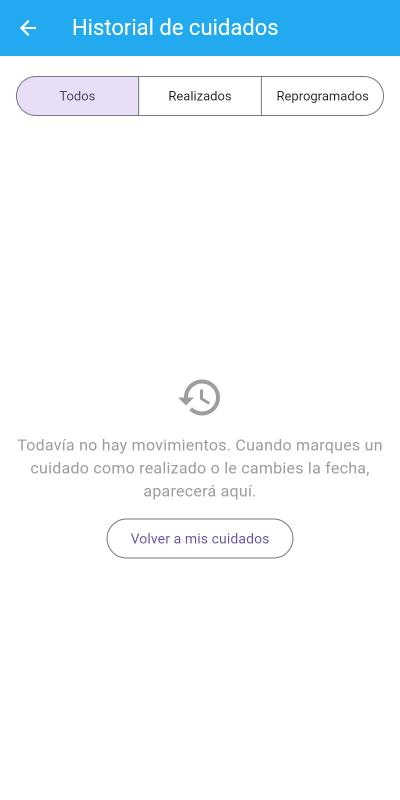
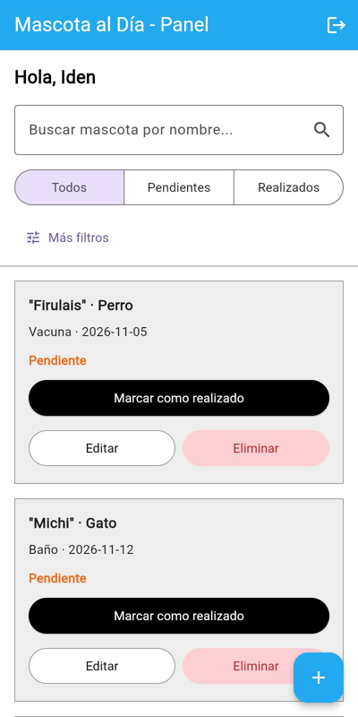
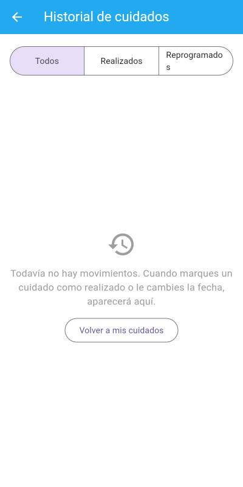
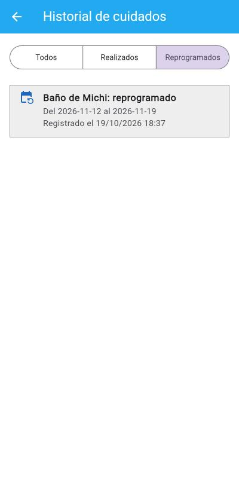
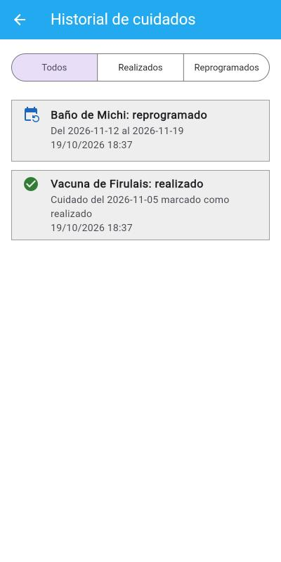
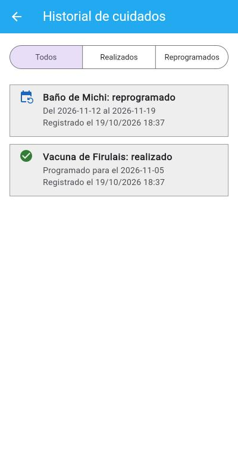

# Decisiones de interacción — Historial de cuidados (Tarea 4)

- **Clase:** 16 · Decisiones de interacción.
- **Issue principal:** #18 · Sub-issues: #19 (datos), #20 (consulta), #21 (interfaz), #22 (pruebas).
- **Pregunta que responde el historial:** ¿qué cuidados se realizaron o reprogramaron?
- **Capturas:** `docs/evidencias/clase-16/` (web, 400 px de ancho).

## Cómo funciona

1. Al marcar un cuidado como realizado o cambiarle la fecha, el backend guarda un evento en la tabla `eventos` (`backend/mascotas/router.py`, funciones `completar_cuidado` y `editar_mascota`).
2. `GET /api/historial/` devuelve solo los eventos del usuario del token, del más reciente al más antiguo (`backend/historial/router.py`).
3. La pantalla `HistorialScreen` muestra la lista y se abre con el botón "Historial" del panel (`frontend/lib/features/historial/screens/historial_screen.dart`).
4. Como los eventos están en la base de datos, siguen ahí después de recargar la app o cerrar sesión.
5. Si la persona todavía no tiene eventos, se muestra un estado vacío que explica qué hacer:



---

## 1 · Fitts — Entrada al historial fácil de alcanzar

| Antes | Después |
| :---: | :---: |
|  |  |

- **Antes:** no había forma de ver lo que pasó con un cuidado. La barra superior solo tenía el ícono de cerrar sesión.
- **Decisión:** poner el botón "Historial" en la barra superior del panel, que siempre está visible, con ícono **y** texto. Así el objetivo es más ancho que un ícono solo y no queda pegado al botón de cerrar sesión.
- **Código:** `frontend/lib/features/mascotas/screens/home_screen.dart` líneas 444-455 (`TextButton.icon` con `Icons.history`).

## 2 · Hick — Pocas opciones para filtrar el historial

| Antes | Después |
| :---: | :---: |
|  |  |

- **Antes:** en la primera versión el filtro tenía las tres opciones, pero "Reprogramados" se partía en dos líneas y costaba leerlo y compararlo con las otras.
- **Decisión:** el historial solo tiene dos tipos de evento, así que el filtro tiene **tres opciones** a la vista (Todos, Realizados, Reprogramados) en un solo control, en vez de copiar los filtros del panel (nombre, tipo de cuidado, fechas). Además se achicó un poco la letra para que las tres opciones entren en una línea.
- **Código:** `frontend/lib/features/historial/screens/historial_screen.dart` líneas 121-145 (`SegmentedButton` con tres segmentos) y el filtro `tipo` en `backend/historial/router.py` líneas 19-20.

## 3 · Carga cognitiva — Cada evento dice primero lo necesario

| Antes | Después |
| :---: | :---: |
|  |  |

- **Antes:** el evento realizado repetía la información ("Cuidado del 2026-11-05 marcado como realizado") y ocupaba dos líneas. La fecha y hora de abajo no decía qué era: había que adivinar si era la fecha del cuidado o cuándo se hizo la acción.
- **Decisión:** cada tarjeta se lee en tres pasos sin ir a otra pantalla:
  1. **Qué pasó y con qué mascota** en negrita, con ícono y color según el tipo ("Baño de Michi: reprogramado").
  2. **El resultado** en una línea corta ("Del 2026-11-12 al 2026-11-19" o "Programado para el 2026-11-05").
  3. **Cuándo ocurrió**, con la etiqueta "Registrado el …".
- **Código:** `historial_screen.dart` líneas 82-108 (`_tarjetaEvento`) y los textos del detalle en `backend/mascotas/router.py` líneas 79 y 107.

---

## Prueba

`backend/tests/historial/test_historial.py` comprueba que:

- completar un cuidado genera un evento "realizado";
- reprogramar genera un evento "reprogramado" con la fecha anterior y la nueva;
- editar sin cambiar la fecha no genera evento;
- el historial viene con lo más reciente primero;
- otro usuario no ve ese historial;
- el filtro `?tipo=reprogramado` solo devuelve reprogramaciones.

```bash
cd backend
pytest tests
```

> Nota: hay una tabla nueva (`eventos`). Se crea sola al iniciar el backend con `Base.metadata.create_all`, no hace falta borrar la base de datos.
