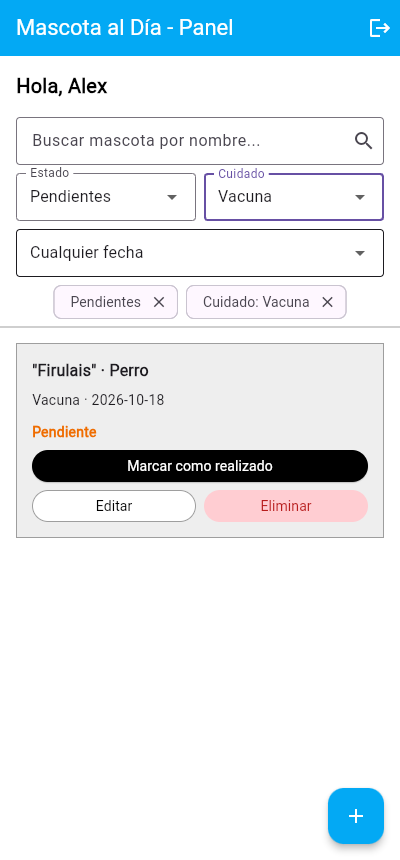
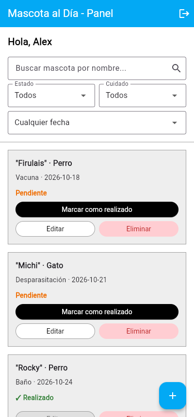
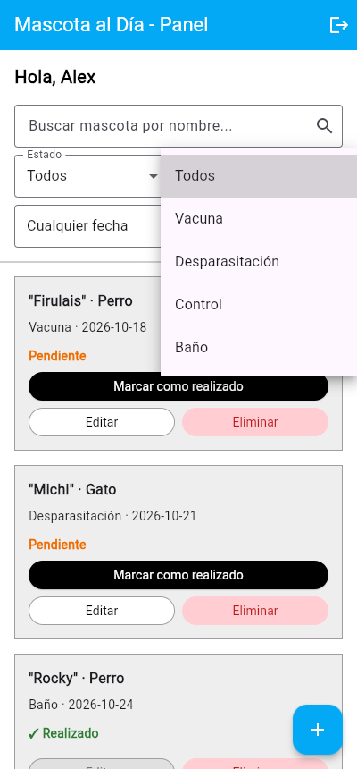
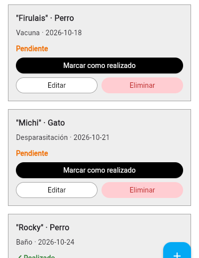
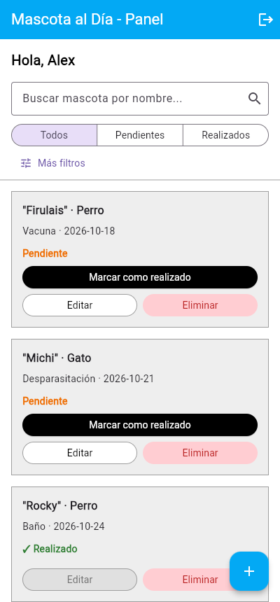
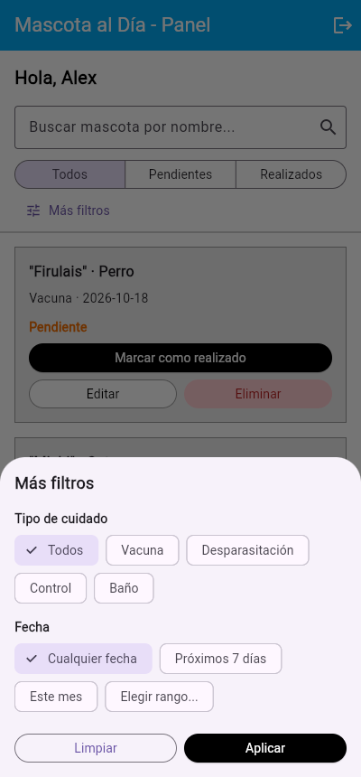
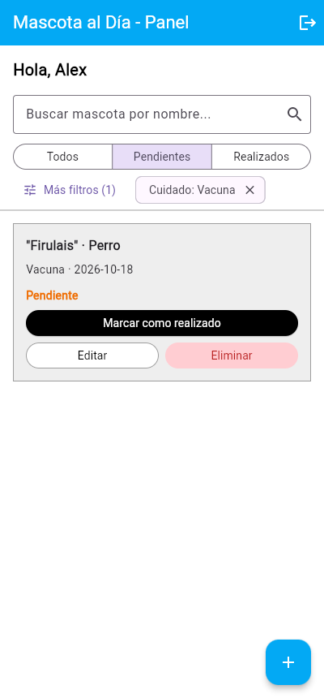

# Hallazgos de interacción (Clase 16) — Mascota al Día

- **Clase:** 16 · Decisiones de interacción (15 de octubre de 2026)
- **Funcionalidad evaluada:** reprogramar cuidados · tipos de cuidado · fecha y estado (panel `HomeScreen`).
- **Datos de prueba:** usuario de prueba con cuatro cuidados: Firulais (Vacuna, 18/10, pendiente), Michi (Desparasitación, 21/10, pendiente), Rocky (Baño, 24/10, realizado) y Luna (Control, 05/11, pendiente).
- **Capturas:** `docs/evidencias/clase-16/` (web, 400 px de ancho).

## Resumen

| Hallazgo | Captura obligatoria | Justificación breve | Estado al terminar |
| :--- | :--- | :--- | :--- |
| **Fitts** | Acción difícil de alcanzar: la "X" para quitar un filtro activo. | Tamaño: un ícono de 18 px dentro del chip. | Documentado. |
| **Hick** | Opciones que compiten: búsqueda + tres desplegables de filtro abiertos a la vez. | Cantidad y prioridad: 4 controles y 12 opciones con el mismo peso visual. | Documentado y **corregido**. |
| **Carga cognitiva** | Información que exige esfuerzo: la fecha del cuidado en formato `2026-10-18`. | Qué debe interpretar y comparar: traducir la fecha y calcular cuánto falta. | Documentado. |

---

## 1 · Fitts — Quitar un filtro activo

- **Dónde:** `frontend/lib/features/mascotas/screens/home_screen.dart`, sección "Filtros activos" (los `Chip` con `deleteIcon: Icon(Icons.close, size: 18)`).
- **Tarea concreta:** después de filtrar por "Pendientes" y "Vacuna", la persona quiere quitar solo uno de los dos filtros.
- **Esfuerzo observado (alcanzar):** el único lugar que quita el filtro es la "X" de 18 px. Tocar el texto del chip no hace nada, así que hay que apuntar con precisión a un objetivo más chico que la yema del dedo y pegado al chip vecino.
- **Justificación:** objetivo pequeño y con área activa limitada al ícono. El chip completo ya es visible y grande, pero no es interactivo.
- **Corrección propuesta (a futuro):** que todo el chip sea el área activa para quitar el filtro (o un `InputChip` con al menos 48 × 48 px de área táctil) y un botón "Limpiar filtros" de ancho completo cerca de los chips.

## 2 · Hick — Demasiados filtros compitiendo (priorizado)

- **Dónde:** `home_screen.dart`, secciones "Barra de búsqueda" y "Controles de filtro" (desplegables Estado, Cuidado y Fecha).
- **Tarea concreta:** la persona entra al panel para ver qué cuidados le quedan pendientes.
- **Esfuerzo observado (elegir):** antes de ver la lista aparecen cuatro controles con el mismo peso: búsqueda, Estado (3 opciones), Cuidado (5 opciones) y Fecha (4 opciones). Las opciones están escondidas dentro de cada desplegable, así que para saber qué puede elegir tiene que abrirlos uno por uno. La decisión más frecuente (pendientes o realizados) compite con filtros que casi no se usan, y los controles de filtro ocupan unos 180 px antes de la primera tarjeta.
- **Justificación:** cantidad (4 controles, 12 opciones) sin prioridad ni agrupación. Siguiendo la Ley de Hick, cuantas más opciones compiten, más tarda en decidir.
- **Corrección:** dejar visible solo lo frecuente y agrupar el resto en "Más filtros". Detalle en la sección [Corrección aplicada](#corrección-aplicada-hick).

## 3 · Carga cognitiva — Leer la fecha del cuidado

- **Dónde:** `home_screen.dart`, tarjeta de cada cuidado (`'${mascota['cuidado']} · ${mascota['fecha']}'`).
- **Tarea concreta:** decidir qué cuidado atender primero.
- **Esfuerzo observado (comprender):** la fecha llega tal cual de la API (`2026-10-18`). La persona tiene que leer un formato técnico, traducirlo a día y mes, recordar la fecha de hoy y calcular cuántos días faltan para cada tarjeta, comparando entre tarjetas.
- **Justificación:** qué debe interpretar (formato año-mes-día) y comparar (la fecha con hoy). La interfaz agrega trabajo mental que podría hacer ella.
- **Corrección propuesta (a futuro):** mostrar la fecha en lenguaje natural ("sáb 18 oct") junto con un texto relativo ("en 3 días", "mañana", "vencido") y destacar los que vencen esta semana.

---

## Corrección aplicada (Hick)

Se aplicó el patrón **"Prioridad"**: lo frecuente queda visible y el resto se agrupa en "Más filtros".

| Antes | Después | "Más filtros" abierto | Filtros aplicados |
| :---: | :---: | :---: | :---: |
|  |  |  |  |

**Qué cambió:**

1. **Estado siempre visible y sin abrir nada.** El desplegable de Estado se reemplazó por un control segmentado `Todos · Pendientes · Realizados`. Las tres opciones se ven de una vez y se eligen con un toque (`home_screen.dart:483-500`).
2. **Tipo de cuidado y fecha agrupados en "Más filtros".** Los dos desplegables menos usados salen del panel y pasan a una hoja inferior con dos grupos con título ("Tipo de cuidado" y "Fecha"). Las opciones se muestran como chips, así que se pueden comparar sin abrir menús (`home_screen.dart:50-211`, `_abrirMasFiltros`).
3. **Una sola decisión por vez en la hoja.** Los cambios se confirman con **Aplicar** (o se descartan con **Limpiar** o cerrando la hoja), así la lista no se recarga con cada toque.
4. **Se ve qué está aplicado sin abrir la hoja.** El botón muestra cuántos filtros secundarios hay activos, por ejemplo "Más filtros (1)", y al lado quedan los chips de los filtros activos (`home_screen.dart:502-554`). Se quitó el chip de Estado porque ya se ve en el control segmentado y estaba duplicado.

**Comparación:**

| | Antes | Después |
| :--- | :---: | :---: |
| Controles de filtro en el panel | 4 (búsqueda + 3 desplegables) | 3 (búsqueda + estado + "Más filtros") |
| Opciones que hay que abrir un menú para ver | 12 | 0 en el panel; 9 agrupadas en "Más filtros" |
| Altura de los filtros antes de la primera tarjeta | ~180 px | ~140 px |
| Toques para ver solo pendientes | 2 (abrir desplegable + elegir) | 1 |

**Comprobación en la aplicación:** con el usuario de prueba se tocó "Pendientes", luego "Más filtros" → "Vacuna" → "Aplicar". La lista mostró solo a Firulais (Vacuna, pendiente), el botón cambió a "Más filtros (1)" y apareció el chip "Cuidado: Vacuna" (captura `hick-despues-aplicado.png`).

**Fuera de alcance (quedan para después):** los hallazgos de Fitts (la "X" de 18 px de los chips) y de carga cognitiva (fecha en formato `2026-10-18`) siguen documentados arriba y no se corrigieron en esta entrega.
